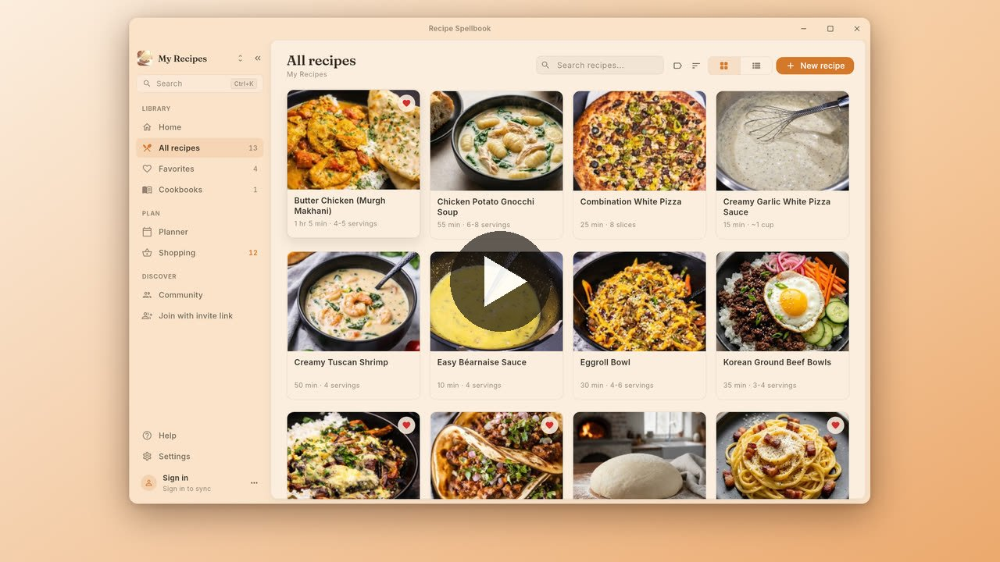
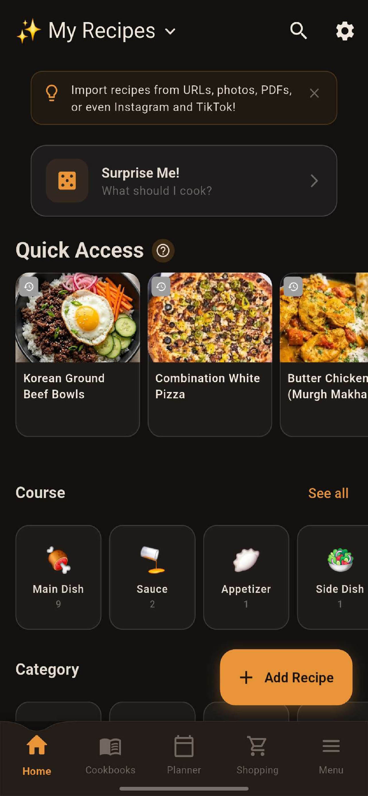
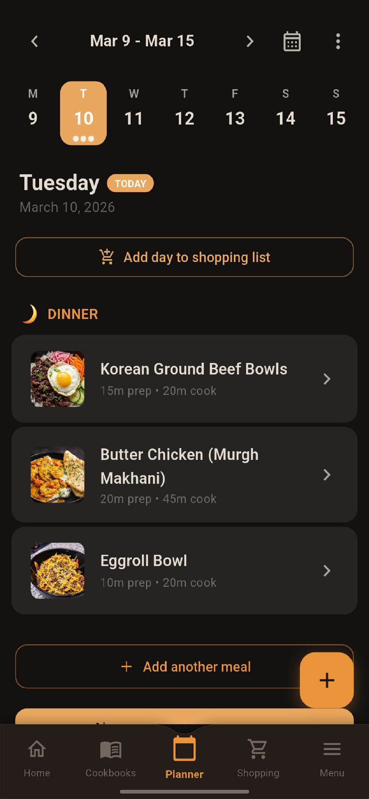
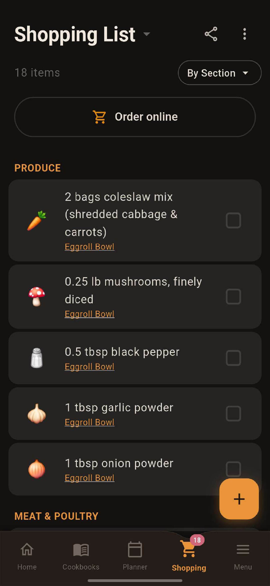
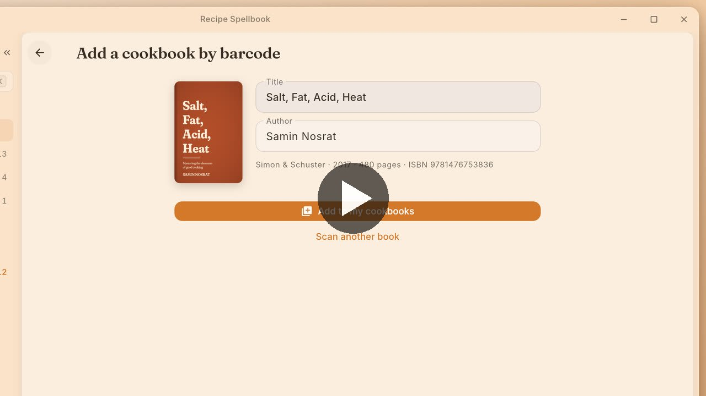
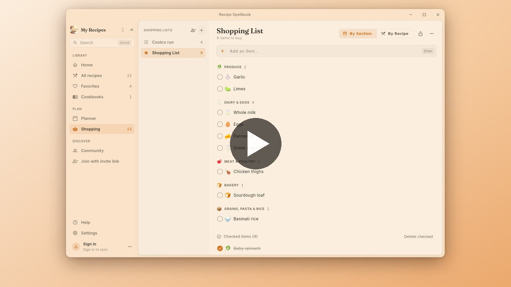
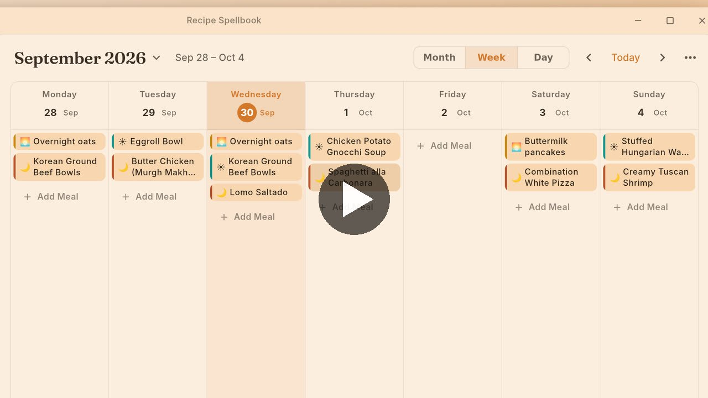
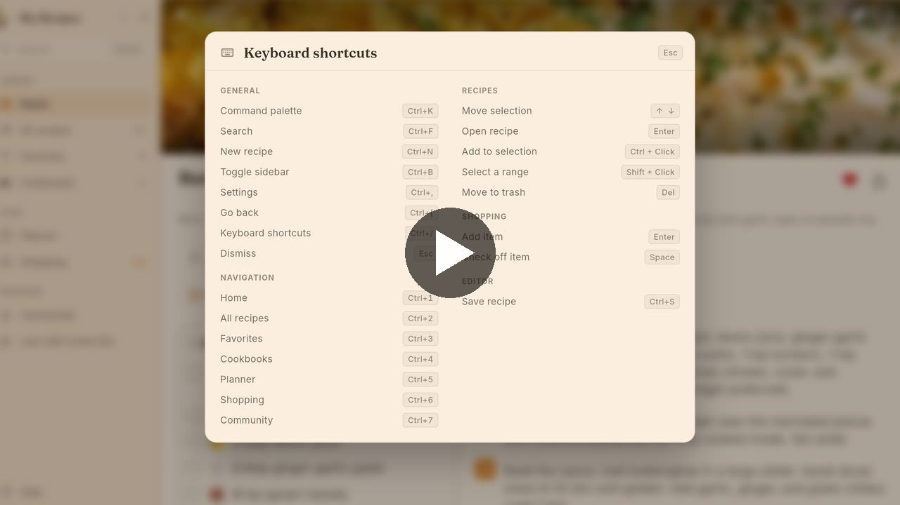

# Recipe Spellbook

**Every recipe you've saved, finally in one book.**

The link in your notes app. The photo of your grandmother's card. The export from the app you're leaving.
Recipe Spellbook turns all of it into real recipes you can scale, plan, shop from and cook with, on every device you own.

[**Website**](https://recipespellbook.app) ·
[**App Store**](https://apps.apple.com/us/app/recipe-spellbook/id6759309654) ·
[**Google Play**](https://play.google.com/store/apps/details?id=com.affluentlabs.recipespellbook) ·
[**Desktop**](https://recipespellbook.app/download) ·
[**Community cookbooks**](https://recipespellbook.app/community) ·
[**Discord**](https://discord.gg/NnkUwxSdFX)

Android · iPhone · iPad · Windows · macOS · Linux

Free to use. Premium is a one-time purchase, never a subscription.

<a href="https://recipespellbook.app/videos/01-overview.mp4">
  <picture>
    <source media="(prefers-color-scheme: dark)" srcset=".github/readme/01-overview-dark.jpg">
    
  </picture>
</a>

The quick tour, 0:34. Cookbooks, recipes, the planner and shopping lists.

 

  
  &nbsp;&nbsp;
  
  &nbsp;&nbsp;
  

## Bring in recipes from anywhere

- **Links:** paste a recipe page and get the ingredients, steps, times and photo, without the life story.
- **Photos and PDFs:** a recipe card, a magazine page or a screenshot becomes an editable recipe.
- **Other apps:** reads Paprika's `.paprikarecipes` export with photos, plus exports from other recipe managers. You review everything before it saves.
- **AI:** paste what a chatbot gave you, and untick any recipe you don't want.
- **Your cookbook shelf:** scan the barcode on the back cover and the book joins your library with its title, author and cover. Photograph the pages you cook from and each recipe files itself into that book.

## Then actually cook from them

| | |
|---|---|
| **Cook mode that listens** | One step at a time, screen awake, timers pulled from the step text. Say "next", "back" or "set timer for 5 minutes". |
| **Shopping, sorted by aisle** | Pick recipes or a whole week of meals and get one list, grouped the way the store is laid out. |
| **Plan by month, week or day** | Drop recipes onto a time, then send the whole week to your shopping list in one tap. |
| **Nutrition per serving** | Calculated from the ingredients. Scan a product's barcode to read its label. |
| **Scaling that survives fractions** | Double 1 ½ tablespoons and get 3, not 2.99999. Metric and imperial convert both ways. |
| **Live shared lists** | Someone's at the store, you're home remembering eggs. Every addition and tick shows up on everyone's phone. |
| **Community cookbooks** | Publish a cookbook, or download someone else's whole shelf as a copy that's yours to edit. |

## See it in action

<table>
  <tr>
    <td width="50%">
      
       <b>Add a cookbook by barcode</b> · 0:28 Scan it or type the ISBN; title, author and cover fill in.
    </td>
    <td width="50%">
      
       <b>Shop by aisle</b> · 0:29 Lists sorted by aisle, and joining someone else's with a link.
    </td>
  </tr>
  <tr>
    <td width="50%">
      
       <b>Plan your week</b> · 0:26 Pick a recipe for any day, in month, week or day view.
    </td>
    <td width="50%">
      
       <b>Built for the keyboard</b> · 0:22 Search, shortcuts and Ctrl 1 to 7 on the desktop app.
    </td>
  </tr>
</table>

## One book on every screen you cook near

Phone at the stove, tablet on the counter, laptop for Sunday planning. Recipe Spellbook runs natively on Android, iPhone, iPad, Windows, macOS and Linux. Everything lives on the device first, so it works offline. The desktop apps have a sidebar, keyboard shortcuts and a command palette (Ctrl K).

## Pricing

| Free: the whole kitchen, on each device | Premium: one-time purchase |
|---|---|
| Unlimited recipes | Everything in Free |
| Import from links, photos, PDFs, files and AI | Cloud sync across all your devices |
| Cookbook barcode scanning | Family sharing for up to 5 people |
| Meal planner and aisle-sorted shopping lists | Shared cookbooks and meal plans |
| Live shared shopping lists | Automatic backups |
| Cook mode with voice control | 2 GB of cloud photo storage |
| Nutrition and step-by-step photos | |

Upgrade inside the app on any device and it unlocks everywhere you sign in. Current price on the [pricing page](https://recipespellbook.app/pricing).

## Switching apps?

- [Moving from Paprika](https://recipespellbook.app/import-guide)
- [How Recipe Spellbook compares](https://recipespellbook.app/compare) with Paprika, AnyList, Mela, Plan to Eat, Crouton and Samsung Food
- [Recipe apps without a subscription](https://recipespellbook.app/compare/recipe-apps-without-subscription)

## Built with

[Flutter](https://flutter.dev) on every platform, [Riverpod](https://riverpod.dev) for state and [Drift](https://drift.simonbinder.eu) (SQLite) for the on-device library, so it works offline first. Sync, sharing and Community run on a Node.js API with PostgreSQL. The app is available in 12 languages.

## Help and feedback

- Questions or a bug: [support@recipespellbook.app](mailto:support@recipespellbook.app), or the [feedback page](https://recipespellbook.app/feedback)
- Talk it through: [Discord](https://discord.gg/NnkUwxSdFX)
- [Privacy policy](https://recipespellbook.app/privacy) · [Terms](https://recipespellbook.app/terms) · [Delete your account](https://recipespellbook.app/delete-account)

---

© 2026 Affluent Labs LLC. All rights reserved.
